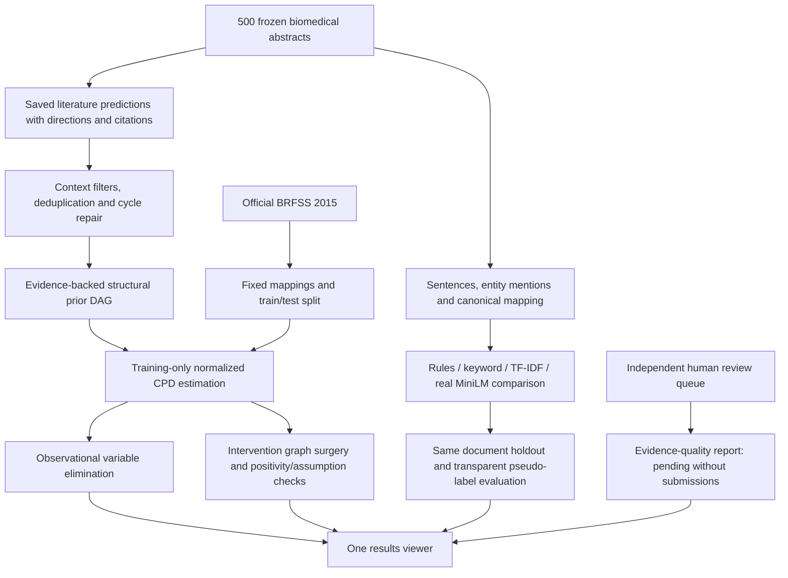

# Integrated project architecture

`src/pipeline.py` orchestrates the entire run through `./run.sh run`. `src/cli.py` also exposes extraction, benchmarking, arbitrary-text prediction, queries, interventions, dataset setup and review commands. The root `run_pipeline.py` preserves old extraction flags and delegates new project commands to the same CLI.

Source modules are grouped by function, not development phase. Shared `CandidatePair` schemas, the canonical registry, YAML loader, frozen corpus, graph builder, and provenance exports are reused. `pgmpy` is a normal project dependency. Tests live together under `tests/unit` and `tests/integration`.

## Controlled NLP comparison

Rules and KeywordHeuristic are distinct deterministic methods. TF-IDF + logistic regression is a trained traditional ML baseline. Actual pinned MiniLM weights provide frozen transformer features; a logistic head is fitted on the same training pair IDs with the same hyperparameters. Learned inputs are token-bounded identically. No training vocabulary, classifier fitting, or hyperparameter selection uses test labels. Fixed model choices are not a matched pretraining-data budget, and pretraining overlap is unknown.

The benchmark compares **relation class** only. It does not invent direction or polarity scores for heads that do not predict them. Class-only outputs cannot silently create a directed DAG. Historical LLM pilots are excluded because they use different pair subsets. The pseudo-label origin biases interpretation even with a correct split protocol.

## Evidence and probability data lineage

The graph stage rebuilds from saved, typed literature predictions, excluding synthetic fixtures and a duplicated legacy model alias. It exports current evidence/provenance under `results/graph/current/`. Those exact files initialize the Bayesian network via a resolved configuration; the model does not use a separately maintained DAG. Evidence sentences and PubMed identifiers are available in the integrated viewer.

The default DAG is `BMICat → Outcome`. Additional configured exploratory edges require explicit rationales, valid canonical endpoints and DAG checks. Isolated extra variables require acknowledgement of the independence assumption. None of these actions changes the accepted literature prior.

BRFSS fields are fixed-codebook mapped, incomplete required model rows are removed, and an outcome-stratified holdout is selected before CPD estimation. Saved model JSON records source hashes, state definitions, training counts, smoothing, splits and evidence provenance. It is not executable pickle.

## Observation versus intervention

A Bayesian network represents a joint distribution by conditional factors; being a valid probabilistic DAG does not establish causal validity. Observation computes P(Y|X=x). Intervention copies the model, cuts incoming arrows to X, sets X's CPD to a point mass, and preserves downstream mechanisms. The original fitted model stays unchanged.

Without asserted causal sufficiency, consistency and acceptance of the structural assumptions, plus empirical support for treatment states, intervention output is `model_simulation_only`. Unsampled cells cannot acquire causal positivity through Bayesian smoothing. The implemented causal operation is truncated factorization for a supplied fully observed DAG, not a general latent-variable do-calculus ID algorithm.

## Artifacts and verification

`results/index.html` is the product entry point. Feature results are in `results/benchmark`, `results/graph/current`, `results/modelling`, and `results/verification`. `project_summary.json` joins every stage. Local raw observations and pretrained weights are reproducibly prepared and excluded from Git.

Tests cover document leakage, shared evaluation IDs, an actual pretrained encoder and portable-head round trip, raw preprocessing, sparse CPDs, graph validity, deterministic holdouts, invalid/impossible evidence, graph-surgery reasoning on a known confounded model, review provenance, and an offline integrated run. Predictive performance, software correctness, human evidence quality and causal validity are separate report fields.
